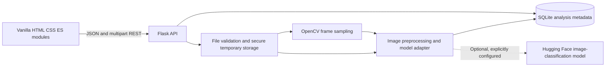

# TruthLens AI

TruthLens AI is a local-first educational web application for transparently screening images and selected video frames for authenticity indicators. It provides a responsive, multi-page vanilla-JavaScript frontend, a Flask API, and SQLite analysis metadata.

> **Important:** No detector model is bundled or activated by default. Until an operator configures a suitable model and the required inference dependencies, detection requests return an explicit `Detection unavailable` result. The application never substitutes a generic image classifier or fabricates a prediction.

## Features

- Image upload screening for JPG, JPEG, and PNG, with signature, MIME, size, dimension, and decode checks.
- MP4 screening with bounded duration, dimensions, decode count, and up to eight sampled frames.
- Transparent frame-based video aggregation using the mean of per-frame AI-label scores and a majority of per-frame top labels. No temporal, audio, or lip-sync analysis is performed.
- SQLite analysis history, deletion, dashboard counts, processing duration, and model metadata.
- Temporary media files are deleted after request processing; database history does not contain uploaded media.
- Responsive interface, keyboard-visible focus, reduced-motion support, and honest unavailable/error states.
- Optional Hugging Face image-classification adapter, enabled only after explicit operator verification and configuration.

## Architecture



Video scores are the arithmetic mean of sampled-frame AI-label scores. The video category indicates whether a strict majority of sampled frames' top labels correspond to configured AI-generated labels; otherwise it reports that no majority was detected. These are screening signals, not calibrated probabilities or definitive authenticity verdicts.

## Folder structure

```text
.
├── backend/
│   ├── ai/                 # Lazy model adapter
│   ├── database/           # SQLite schema and repository
│   ├── routes/             # Health, detection, history and dashboard endpoints
│   ├── services/           # Image and video processing
│   ├── tests/              # Flask test-client and service tests
│   ├── utils/              # Validation, errors and safe display names
│   ├── app.py
│   └── config.py
├── frontend/
│   ├── css/                # Design tokens, base, components, pages, responsive
│   ├── js/                 # API client and page modules
│   └── *.html              # Landing, dashboard, image/video, result, history, about
├── .env.example
├── requirements.txt
└── requirements-ai.txt    # Optional, large inference dependencies
```

## Prerequisites

- Windows 10/11 (commands below use PowerShell).
- Python 3.10 through 3.15 for the core application. AI inference requires a Python version with a compatible PyTorch wheel; the current Windows environment's Python 3.15 prerelease does not have one. Use Python 3.14 for the optional AI model environment.
- Internet access for installing Python packages. A configured Hugging Face model may also need to be downloaded on first inference.
- For actual inference, sufficient disk space and RAM for the selected model; GPU support depends on the installed PyTorch build. The optional model stack is not needed to run the application or its tests.

## Run locally on Windows

From the project root, create a virtual environment and install the core dependencies:

```powershell
py -3 -m venv .venv
.\.venv\Scripts\Activate.ps1
python -m pip install --upgrade pip
python -m pip install -r requirements.txt
```

The Pillow requirement is selected automatically for your Python version. If `pip` previously failed while building Pillow, keep the same activated virtual environment and rerun the install command above; it will install the compatible wheel and then the remaining packages. Confirm which interpreter that environment uses with `python --version`.

If PowerShell prevents environment activation, call the virtual-environment interpreter directly, for example:

```powershell
.\.venv\Scripts\python.exe -m pip install -r requirements.txt
```

Start the complete application from the project root:

```powershell
python -m backend.app
```

The Flask server listens only on `127.0.0.1:5000` and serves the existing frontend at <http://127.0.0.1:5000/>. The API remains under `/api` (for example, <http://127.0.0.1:5000/api/health>); the frontend's configured API base URL is `http://127.0.0.1:5000/api`. The default CORS allowlist includes the backend's own `localhost` and `127.0.0.1` origins so browser module scripts load when the frontend is served by Flask.

Alternatively, to serve the frontend separately with VS Code Live Server, open `frontend\index.html` in VS Code and select **Go Live**. Open the Live Server URL (normally <http://127.0.0.1:5500/>). The default CORS configuration allows `localhost` and `127.0.0.1` on port 5500. Keep the Flask backend running in its own terminal; if Live Server uses another port, add that origin to `TRUTHLENS_CORS_ORIGINS` before starting Flask.

The equivalent standalone static server command, if you do not use Live Server, is:

```powershell
python -m http.server 5500 --directory frontend
```

Open <http://127.0.0.1:5500/>. The API allows the local frontend origins on ports 5500 and 8000 by default. Do not expose the development server to an untrusted network.

The SQLite database is initialized automatically at `backend\truthlens.sqlite3`. Override its location with `TRUTHLENS_DATABASE`. Uploaded media is written to the operating system's temporary directory and removed after processing.

## Detector configuration

There is deliberately no automatically activated detector. One educational candidate was reviewed: [Organika/sdxl-detector](https://huggingface.co/Organika/sdxl-detector). Its model card describes a binary image-classification detector fine-tuned for SDXL-generated images versus human images. The pinned config revision [b37fede](https://huggingface.co/Organika/sdxl-detector/commit/b37fede8562cb72b89ec201c0987f96ba21b518a) exposes the exact labels `artificial` and `human`, which are compatible with the adapter's image-classification inference interface.

At that revision, the model config is a two-class Swin image classifier and the image processor resizes inputs to 224×224, rescales pixel values, then normalizes using means `[0.485, 0.456, 0.406]` and standard deviations `[0.229, 0.224, 0.225]`. The Transformers image-classification pipeline applies this processor to the RGB image and returns label/score pairs. TruthLens stores the `artificial` class score as its screening score; it is a model output, not a calibrated probability.

This candidate is **not a universal authenticity or deepfake detector**: its card says performance may be lower for models other than SDXL. The pinned model card declares CC BY-NC 3.0 and notes the predecessor used training images scraped from Reddit; review the model's non-commercial license, training-data risks, and your institution's requirements before enabling it. The pinned 347 MB checkpoint was downloaded and CPU-smoke-tested in this workspace with Python 3.14.7, PyTorch 2.14.1, and Transformers 4.57.6. That verifies loading and inference only; it is not an accuracy evaluation or evidence of general detector performance. A general image classifier is not automatically an AI-generated-image detector.

Before enabling any model, the operator must confirm its intended task, training/evaluation evidence, exact output labels, license, model revision, and inference interface. Then install the optional dependencies. PyTorch currently has no Windows wheel for the Python 3.15 prerelease in this environment, so create a separate Python 3.14 environment rather than trying to install AI packages into a 3.15 environment:

```powershell
py -3.14 -m venv .venv-ai
.\.venv-ai\Scripts\python.exe -m pip install --upgrade pip
.\.venv-ai\Scripts\python.exe -m pip install -r requirements.txt -r requirements-ai.txt
```

Set environment variables in the same PowerShell window used to run the backend. Stop any already-running Flask process first. The following pins the reviewed educational candidate; use it only after accepting its scope and license/training-data caveats:

```powershell
$env:TRUTHLENS_MODEL_ID = "Organika/sdxl-detector"
$env:TRUTHLENS_MODEL_REVISION = "b37fede8562cb72b89ec201c0987f96ba21b518a"
$env:TRUTHLENS_MODEL_VERIFIED = "true"
$env:TRUTHLENS_AI_LABELS = "artificial"
.\.venv-ai\Scripts\python.exe -m backend.app
```

`TRUTHLENS_MODEL_VERIFIED=true` is an operator acknowledgement, not an automated audit or certification. The adapter rejects absent configuration and mismatched AI labels. If model weights are missing, inaccessible, incompatible, or inference fails, TruthLens returns an explicit unavailable/failed state and logs the exception details in the backend terminal. The API does not return a fabricated score. The model loads lazily once per backend process; first inference downloads the 347 MB model checkpoint and processor config and needs additional memory for PyTorch and model inference. CPU inference is supported; GPU is not required.

After enabling the model, upload a JPG or PNG from the frontend or test the endpoint from PowerShell (replace the sample path with a real image):

```powershell
curl.exe -F "file=@C:\path\to\test-image.jpg;type=image/jpeg" http://127.0.0.1:5000/api/detect/image
```

A successful inference returns HTTP 200 with `status: "completed"`, a numeric `score`, and model metadata. If loading or inference fails, inspect the backend terminal and the API's explicit error response. An unavailable record created before configuring the model is not retroactively reprocessed; upload the image again after restarting.

## API

All responses use JSON. Errors have the form `{"error":{"code":"...","message":"..."}}`. Detection responses include the saved analysis record and its `analysis_id`; when model loading or inference is unavailable, the record includes a persisted `error_message` that is also returned by history lookups. A failed request never includes a fabricated score.

| Method | Endpoint | Purpose |
|---|---|---|
| `GET` | `/api/health` | Backend and detector-configuration status |
| `GET` | `/api/dashboard/stats` | Actual database counts, recent activity, and completed-result distribution for the last 30 days |
| `POST` | `/api/detect/image` | Multipart image upload in field `file` |
| `POST` | `/api/detect/video` | Multipart MP4 upload in field `file` |
| `GET` | `/api/history` | Saved records; optional `limit` from 1 to 200 |
| `GET` | `/api/history/<analysis_id>` | One saved record |
| `DELETE` | `/api/history/<analysis_id>` | Permanently delete one metadata record |

Image uploads are limited to 10 MB, 12,000 pixels per dimension, and 40 million pixels. MP4 uploads are limited to 50 MB, 60 seconds, 3,840 pixels per dimension, and 2,000 decoded frames; the pipeline samples at most eight frames. Flask rejects multipart request bodies larger than 51 MB to allow upload-form overhead.

## Tests

Install the core requirements and run:

```powershell
python -m pytest
```

The tests use isolated SQLite databases and mock inference only in test cases. They cover health, upload validation, unsupported detector behavior, response shape, history, dashboard counts, deletion, and temporary-file cleanup. A passing test run is not evidence that a real detector is installed or accurate.

## Screenshots

No screenshots are checked in yet. Run the application locally and capture the landing page, dashboard, upload flow, and analysis report here when available.

## Troubleshooting

- **API connection error:** Confirm the backend is running at `127.0.0.1:5000` and that the browser uses the configured local origin.
- **Detection unavailable:** This is the expected default until you configure a model after verifying its model card, task, labels, license, and interface.
- **Model load failure:** Check backend terminal logs, model ID/revision, network access, Hugging Face permissions, and installed optional dependencies.
- **Video cannot be opened:** Confirm the file is a valid MP4 with supported codecs and within the configured duration, dimensions, and size limits.
- **PowerShell activation is blocked:** Use `.\.venv\Scripts\python.exe` instead of activating the virtual environment.
- **History database location:** Set `TRUTHLENS_DATABASE` before launching the backend. Uploaded media itself is not kept in the database.

## Future improvements

- Add a separately validated video-temporal or audio detector if its capability and license are verified.
- Add operator-selected, model-specific abstention thresholds only when supported by validation evidence.
- Add automated browser integration tests and deployment hardening before any non-local use.
